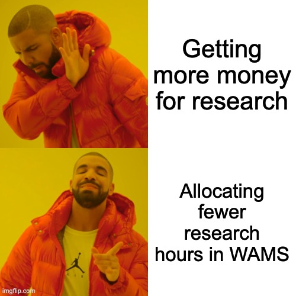

#+TITLE: Research culture: Workload and Investment
#+author: Guy McCusker
#+date: Research Awayday 5/11/2026
#+HTML_HEAD_EXTRA: 
#+include: "./lecture-preamble-light-bath.org"

* We Make Futures

#+ATTR_REVEAL: :frag (appear)
With that in mind, let's talk about something that is in all of our futures: this year's formal workload allocation

* Workload Allocation for Research

Overall, around 30% of department time is allocated to research.

In the current draft workload model, 31000 out of 99000 allocated hours are for research and scholarship activities.

For academic staff with research contracts, the allocation is 26000 out of 61000 hours: around 40%. 

(The current draft does not account for this year's MSc projects yet so these figures will change a little.)

These figures include "university funded research", plus time allocated to PGR students and grants. 

#+reveal: split

The new university strategy has a KPI for research funding:
#+begin_quote
TRAC research recovery rates (59% → 65–70%)
#+end_quote

(The only other research KPI concerns the proportion of internationally-coauthored research papers.)

#+reveal: split

\[
\text{Recovery rate} = \frac{\text{external research income}}{\text{cost of research}}
\]

To increase this ratio we can either win more funding or invest less in research.

#+ATTR_REVEAL: :frag (appear)
Can you guess which we're going to try?v

** What has this got to do with workload?

The university uses WAMS data to calculate the cost of its investment in research.

It calculates what /percentage/ of your time was spent on university-funded research.

Standard allocation = 400 / 1613 hours = 24.7% of your time.

This is the number that feeds into the denominator of the TRAC calculation. 

** The Dean wants to change this

In an email this summer, the Dean announced that the default research allocation should be reduced to 200 hours.

He  proposed that the default position should be /not to fill this 200 hours with other things/.

So the /number on the spreadsheet/ is the only thing that changes.

How does this help?

#+reveal: split

Because of the WAMS/TRAC calculation, reducing this /number/ without changing your work allocation reduces the calculated cost of research!

\[ 200/1413 = 14.2\% \]

Filling the 200 hours with other work does not help much:

\[ 200/1613 = 12.3\% \]

So this sleight of hand will help achieve a KPI without doing anything of any value.
#+reveal: split

#+ATTR_REVEAL: :frag appear

** Does this actually make sense?

#+ATTR_REVEAL: :frag appear
Not really...
#+ATTR_REVEAL: :frag appear
But remember that we are in a world where "research income" is defined to be the amount of money /spent/ on research.
#+ATTR_REVEAL: :frag appear
We're through the looking glass.

  
** Risks

 - The workload allocator might fill the spare time
   - I am trying not to!
 - If the department's workload looks low we might not be able to argue for new staff or investment
 - It sends the wrong message to staff 
 - Surely someone is going to notice?

** What should you do?

 - In your SDPR you are encouraged to make a case to keep the full 400 hour allocation
 - Don't lose sleep over WAMS numbers
 - Continue to do research!

* Departmental Investment in Research

#+ATTR_REVEAL: :frag (appear)
We make futures.
#+ATTR_REVEAL: :frag (appear)
We also invest quite a bit in research infrastructure.

#+reveal:split

2026/27:

 - research group budgets: £137,000
 - investment in Hex GPU cloud: over £300,000
 - summer research interns: 14 12-week internships, £65,000
 - paying tutors to teach so you don't have to: £110,000
 - additionally: start-up funds for new academic staff 

** What did the research groups pay for?

 - Travel and accommodation: 
   - conferences and workshops
   - research visits
   - hosting visitors
 - Conference registrations
 - Equipment:
   - powerful desktop computers for AI applications
   - machines for VR/AR/XR
   - mobile EEG 

** What about this year?

We are able to make investments in research this year.

Each research group lead holds a budget to invest in their group's research. Tom as DHoD (research) has further funds. All these budgets can be increased if there is a need. 

* Footnotes
